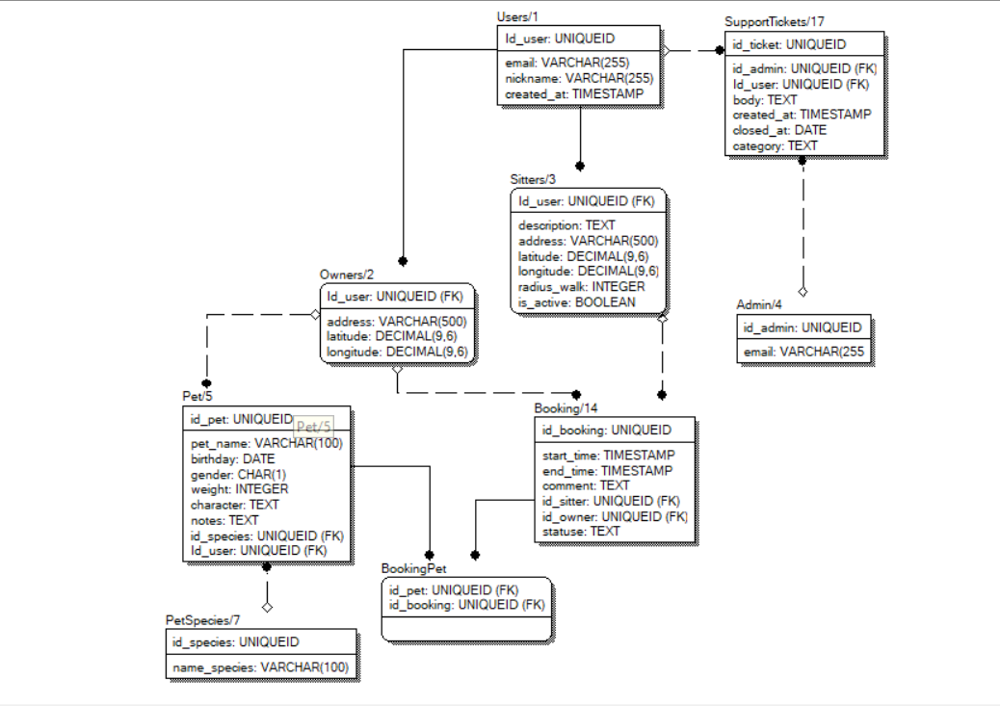

PetSit 

СЫРЫЕ ТРЕБОВАНИЯ (заказчика):
- веб-приложение
- хозяева животных находят ситтеров
- у хозяина может быть несколько питомцев, питомец - не обязательно собака
- ситтер создаёт анкету
- можно обратиться в поддержку
- никаких паспортных данных и проверки личности

Платформа?
- веб-приложение с адаптивным интерфейсом
  Как регистрироваться и входить?
- email и пароль, email одновременно является логином
- хранение пароля в БД в этой версии не предусмотрено (появится позже вместе с авторизацией)
- при регистрации сразу выбирается роль: хозяин или ситтер
- анонимного доступа нет: все пользователи приложения авторизованы,
  аккаунтов без роли быть не должно

Какие данные о человеке нужны?
- email (логин) и никнейм (отображаемое имя)
- паспорт и проверка личности не нужны

Один человек может быть и хозяином, и ситтером?
- да, один аккаунт, два профиля, между интерфейсами можно переключаться

Как задаётся зона выгула?
- ситтер указывает адрес и радиус в километрах
- для расчёта расстояний хранятся координаты (широта и долгота)

Адрес хозяина обязателен?
- нет, без адреса анкеты ситтеров показываются в случайном порядке

Что происходит после выбора ситтера?
- хозяин создаёт заявку: ситтер, даты, питомцы, комментарий
- оплаты в приложении нет

Кто обрабатывает обращения в поддержку?
- администратор

Как создаются администраторы?
- вручную, через регистрацию стать администратором нельзя

Вне этой версии (добавим позже):
- диалоги и сообщения между хозяином и ситтером
- фотографии питомцев и ситтеров
- справочник видов услуг (выгул / ситтинг с проживанием / передержка)
  и выбор услуг ситтером
- выбор ситтером видов животных и фильтр анкет по виду питомца
- отзывы и оценки
- отдельные справочники статусов заявок и категорий обращений
  (в этой версии хранятся текстом)

Требования (PoC):

Неавторизованный посетитель должен иметь воз-ть:

- открыть страницу входа и регистрации
- зарегистрироваться (email, пароль, никнейм, выбор роли: хозяин / ситтер)
- войти
  Анкеты ситтеров и питомцы ему недоступны.

Любой авторизованный пользователь должен иметь воз-ть:

- выйти из аккаунта
- переключаться между интерфейсом хозяина и интерфейсом ситтера
  (если у него есть оба профиля)
- обратиться в поддержку (категория: жалоба / вопрос / другое, текст обращения)
- видеть список своих обращений и информацию о том, закрыты ли они

Хозяин должен иметь воз-ть:

- создать профиль хозяина
- указать адрес (необязательно)
- добавить питомца: имя, вид (из справочника), дата рождения, пол, вес,
  характер, особые заметки
- изменить и удалить питомца (питомцев может быть несколько)
- смотреть анкеты ситтеров (только активные)
- сортировать анкеты по расстоянию от хозяина; если адрес не указан -
  анкеты показываются в случайном порядке
- открыть анкету ситтера
- создать заявку: ситтер, даты начала и окончания, питомцы, комментарий
- отменить заявку

Ситтер должен иметь воз-ть:

- создать анкету: описание, адрес, радиус выгула (км)
- временно скрыть анкету из поиска
- смотреть входящие заявки
- подтвердить или отклонить заявку
- отметить заявку выполненной

Администратор должен иметь воз-ть:

- войти в личный кабинет
- посмотреть список обращений
- открыть обращение
- взять обращение в работу (назначить себя ответственным)
- закрыть обращение
- редактировать справочник видов питомцев

В системе 3 роли: хозяин, ситтер, админ.
Хозяин и ситтер - это не отдельные аккаунты, а профили одного пользователя
(у человека может быть один из них или оба).

Сущности:

- Users (пользователь) - id, email (логин, уникальный), никнейм,
  дата регистрации

- Owners (профиль хозяина) - пользователь (PK и FK одновременно),
  адрес (необязательно), координаты (необязательно)

- Sitters (анкета ситтера) - пользователь (PK и FK одновременно),
  описание, адрес, координаты, радиус выгула (км),
  признак "анкета активна"

- Admin (администратор) - id, email

- Pet (питомец) - хозяин (FK), вид (FK), имя, дата рождения, пол, вес,
  характер, особые заметки

- PetSpecies (вид питомца) - id, название (справочник)

- Booking (заявка) - хозяин (FK), ситтер (FK), начало, конец, статус,
  комментарий

- BookingPet (питомец в заявке) - заявка (FK) + питомец (FK),
  связь многие-ко-многим между Booking и Pet

- SupportTickets (обращение) - отправитель (FK на Users), ответственный
  админ (FK на Admin), текст, категория, дата создания, дата закрытия

Корзины и платежей в системе нет.

Ограничения:
- хеш пароля в БД пока не хранится: авторизация и хранение паролей
  будут добавлены позже
- email (логин) уникален
- при регистрации пользователь создаёт хотя бы один профиль (хозяина и/или
  ситтера); аккаунт без профиля не допускается (проверяется в приложении)
- администраторы создаются вручную и не регистрируются через приложение
- питомец принадлежит ровно одному хозяину
- нельзя создать заявку самому себе (хозяин и ситтер - один пользователь)
- в заявке можно указать только питомцев этого хозяина (проверяется
  в приложении)
- широта и долгота задаются только вместе
- радиус выгула больше нуля
- дата окончания заявки позже даты начала
- статусы заявки: ожидает, подтверждена, отклонена, отменена, завершена
- категории обращения: жалоба, вопрос, другое
- обращение считается закрытым, если заполнена дата закрытия
  